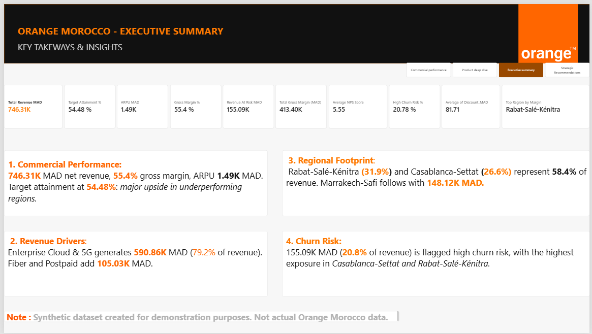
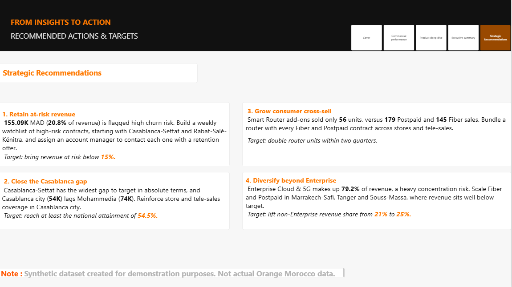

# Orange Morocco – Commercial Performance & Churn Risk Dashboard

> ⚠️ **Synthetic dataset** created for demonstration purposes. Not actual Orange Morocco data.
> Independent portfolio project, not affiliated with Orange.

· 📄 [PDF version](docs\telecom_analysis.pdf)





## Business questions
1. Are we reaching our commercial targets, and where is the gap largest?
2. Where does revenue come from (region, product, channel)?
3. How much revenue is at risk from churn, and where is it concentrated?

## What's inside
| Folder | Content |
|---|---|
| `data/` | Synthetic dataset (=500 transactions, 6 regions, 5 product lines) 
| `sql/` | PostgreSQL queries reproducing the dashboard KPIs |
| `powerbi/` | `.pbix` file, DAX measures, KPI definitions |
| `docs/` | Screenshots, data model, PDF export |

## Key findings
- Enterprise Cloud & 5G generates **79.2%** of revenue → concentration risk.
- **155.09K MAD (20.8% of revenue)** sits in high-churn-risk transactions.
- Target attainment is **54.48%**; the widest gap is in Casablanca-Settat.

## Recommendations

- **Retention watchlist for high-risk accounts**

- **Closing the Casablanca gap**

 - **Router cross-sell**

  - **Diversification beyond Enterprise**(details on dashboard page 4).

## Method


The project follows an end-to-end BI workflow, from raw data to executive recommendations.

### 1. Data source
The dataset is synthetic: = 500 transactions, Jan 2025 – Sep 2026, generated with Python . It covers 6 regions, 13 cities, 5 product lines, 5 sales channels and 5 customer segments, with revenue, target, gross margin, discount, NPS and a churn-risk label. See `data/data_dictionary.md` for each column.

### 2. Data connection and cleaning (Power Query)
- Connected Power BI Desktop to the CSV files
- Set the correct **data types** for every column (dates as Date, amounts as Decimal Number, identifiers and categories as Text, counts as Whole Number).
- Checked for nulls, duplicates and inconsistent labels (region, city and product names) and standardised them.
- Renamed columns to clear business names and removed unused ones.
- Kept every transformation as a documented Applied Step, so the pipeline is repeatable on refresh.

### 3. Data modelling
- Built a model around the sales table, with a dedicated **Calendar** table.
- Created one-to-many relationships (Calendar → Sales on date) with single-direction filtering.
- Marked the Calendar table as the model's date table.
- Hid technical columns and grouped measures in a dedicated measures table.

### 4. Calendar table (DAX)
Created a Calendar table with DAX so every time-based analysis uses one consistent date axis:

```DAX
Calendar =
ADDCOLUMNS(
    CALENDAR(DATE(2025, 1, 1), DATE(2026, 12, 31)),
    "Year", YEAR([Date]),
    "Month Number", MONTH([Date]),
    "Month", FORMAT([Date], "MMM"),
    "Year-Month", FORMAT([Date], "YYYY-MM")
)
```
The Year-Month column is sorted by Date, which keeps months in chronological order on the trend chart.

### 5. KPI measures (DAX)
Wrote the business measures in DAX. The main ones:
- **Total Revenue MAD**, **Total Target MAD** and **Target Attainment %**
- **Gross Margin %** and **ARPU MAD**
- **Revenue At Risk MAD** (revenue of high-churn-risk transactions) and **Revenue at Risk %**
- **High-Risk transactions %** (share of transactions, not of revenue)
- Average NPS, average discount and top region by margin

Each measure is documented in `powerbi/dax_measures.md`, and each KPI is defined in `powerbi/kpi_definitions.md`.


### 6. Report design
Built a 5-page report (a cover plus four analysis pages) with a consistent visual identity: dark banner, orange accent, KPI cards, synchronised slicers and a page navigator.

0. **Cover:** project title and headline KPIs.
1. **Commercial Performance:** KPIs, revenue vs target by region, monthly trend, product and channel mix.
2. **Regional & Product Deep Dive:** segments, margin, churn risk by region, city ranking, product volume.
3. **Executive Summary:** key takeaways in plain business language.
4. **Strategic Recommendations:** four actions, each with a target.

Slicers (Region, Product Line, Year-Month) are synchronised across pages.

### 7. SQL analysis (PostgreSQL)

Loaded both CSV files into PostgreSQL and used SQL to validate the Power BI report and to go further than the dashboard:

- **KPI validation:** recomputed total revenue, gross margin %, target attainment (join with `regional_targets`), revenue at risk and ARPU, and matched them to the report.
- **[Regional analysis]:** [e.g. gap to target by region, city ranking within each region (window functions)]
- **[Churn analysis]:** [e.g. revenue at risk by segment × region, share of high-risk transactions]
- **[Product / channel analysis]:** [e.g. revenue concentration by product line, margin by product]
- **[Trend analysis]:** [e.g. monthly revenue and month-over-month change with LAG]

Each query is commented with the business question it answers. See `sql/`.

### 8. Insights and recommendations
Turned the analysis into four data-backed recommendations (retention watchlist, closing the Casablanca gap, router cross-sell, diversification beyond Enterprise). The targets are illustrative, as the data is synthetic.


## Tools
Power BI · DAX · Power Query · PostgreSQL · Visual Studio Code · Python (data generation)

## Author
Yassamine Moudrik – [LinkedIn](https://www.linkedin.com/in/yassamine-modrik-a2ab65278/) · [Email](mailto:yassaminemodrik@gmail.com)